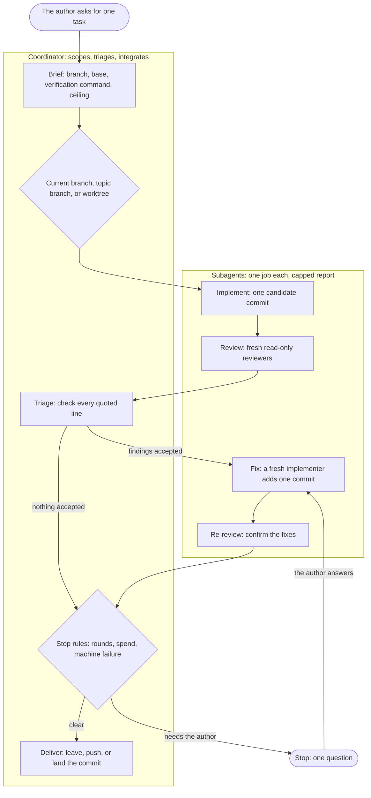

# Orchestration

This file records why each rule in the `orchestrate`, `delegate` and `dispatch` skills exists, so that nobody re-argues or quietly reverts a rule.

To add an entry, write one bullet per rule with one to three sentences on the failure it prevents, and no dates, hashes or history.

Reasons for reviewer rules live in the [review reason log](../skills/review/README.md).

## Which skill does what

| The work | Skill |
| --- | --- |
| One repository task, from brief to a reviewed commit | `orchestrate` |
| Bounded units whose results return to the current session | `delegate` |
| A fresh session whose result is a commit or a report | `dispatch` |
| Coordinate isolated reviewers of a change or a plan, and check their reports | `review` |
| A written plan that spans several sessions | `phased-plan` |
| The cheapest topology for a large task, before it starts | `preplan` |

`review` coordinates isolated reviewers. Its [selection step](../skills/review/SKILL.md#1-determine-what-to-review-and-load-its-rules) decides which rules a reviewer receives. Project-specific review rules stay with the caller, which owns their names and locations. The public runner stays independent of private project instructions.

## How a task runs

A small coherent task runs inline, with one reviewer.

## Principles

1. Keep writes in one thread. Extra agents add judgement, not actions.
2. Pass decisions with the task. A unit that cannot see them makes its own, and the two sets clash.
3. The bill is the number of round trips. Every call re-sends the whole conversation.
4. Put a large context where it is paid for once. A subagent reads the code, and the coordinator does not pay for it on every call.
5. Cap each report at launch. A report stays in the coordinator's context for the rest of the task.
6. One job, one agent, one round. A fresh agent costs less and does not defend its own work.
7. Give a unit a number, not an adjective. A tool-call budget with the price of one round trip binds. "Be efficient" does not.
8. Use an automatic completion path. A poll costs a full call and learns one bit.
9. Stop on a rule, not on a feeling. Fixed limits end a task that is not converging.
10. Delegate retrieval down, never judgement. Cheap auditors skipped whole files and reported complete coverage.

## Brief

- The [worker brief contract](../skills/references/owner-brief.md) keeps the owner's words apart from agent inferences. Otherwise reviewers treat implementation choices as requirements.
- Reader labels identify work the reader follows. Inherited labels on internal workflow workers obscure that work. Parent/child links keep those workers discoverable.
- The coordinator reads the skill again at every invocation. A long thread keeps the text it loaded first.
- Brief saves the loaded skill bytes and their source. Another session can change the skill during the run.
- Brief names the shared resources. Caches, services and devices are shared with every session, and a collision gives no warning.
- A command that gains a new place to run from is cross-component. It moves shared state, and one such run spent twice its ceiling.
- The brief requires a test for each place a command runs from. Otherwise a command that is dead in its new place reaches review.
- A need the harness cannot reach stops once, at Brief. Fresh runs of one plan otherwise stopped on it again and again.
- That answer goes into the plan file at once. Compaction loses an answer held in chat.

## Retained action effects

A move of an action to a new owner can drop a visible effect while the return value stays the same. The brief names those effects, so a check exercises the action through its new owner. Existing coverage is enough when it reaches them.

## Run evidence

- Run evidence goes in the plan's `runs/` folder. A separate folder needs its own ignore rules and parts the evidence from its plan.
- The run folder stays outside every worktree. Saved source copies there enter the candidate's checks.
- Brief creates the run folder exclusively. Two concurrent runs otherwise share it.
- A run lists the large files it wrote into a plan folder. A repository that tracks only Markdown hides them from `git status`.

## Implementation

- A fresh implementer runs each fix round. A reused one defends its work and carries the first round's context.
- A design change stops the running implementer instead of reaching it by message. One implementer took such a message as an injection and spent the last round on the old design.
- The implementer names its choices in the commit body. A fresh fixer undoes a choice it cannot see.
- The implementer reports the reproduction it ran. One regression test covered a simulated path instead of the reported one, and a later run redid the fix.
- The implementer does its own work. Helpers returned nothing in one round, and a helper cannot run the gate.
- A candidate's sole parent is the base commit. Any other parent brings changes the task did not ask for.
- A false comment in an out-of-scope file still gets fixed. An implementer told to leave a file alone leaves the comment too.
- Two writers run in parallel only when the brief fixes every shared choice. In Cognition's example, two agents built game parts in separate files that did not match.
- A task too large for one implementer splits into phases. A second implementer that finishes the work pays again for everything the first read.
- A context overrun alone does not block review of a green commit. The commit holds the work, and review shows what remains.
- An implementer keeps its last five calls for its commit and report. Without a commit, the round is wasted.

The implementer iterates with the project's iteration command, or with the tests its change touches, and runs the full gate once per candidate SHA. One run spent 37 of its implementer's 68 minutes waiting on repeated full `npm test` runs, while the project's instructions already named a faster iteration command. The full gate still decides delivery, so the narrower loop moves an integration failure later but never lets one land.

## Review

- One task has one candidate commit. A shared tree changes under the reviewer.
- Reviewers start fresh and stay read-only. A shared context inherits blind spots, and an editing reviewer mixes faults with its own changes.
- Reviewers run in parallel. They read the same commit, so an order gains nothing.
- A cross-component change adds a reviewer from another model family. Reviewers from one family miss the same things.
- A reviewer opens the before-and-after images. Unopened images let stretched buttons pass review.
- A reviewer names the cost at production scale. One defect passed three reviews at fixture size, then froze the author's workspace.
- Every finding quotes its line. The coordinator then checks every finding in one call, without reading the code.
- Reviewers check the factual claims in the brief. A reviewer that accepts a false premise approves code that misses the goal.
- The review prompt says the implementer proved each new test. A reviewer cannot read that report and calls the proof missing.
- A reviewer out of budget is resumed once while its cache is warm. That costs less than a new reviewer. A cold resume rewrites the reviewer's whole context, so the supplemental reviewer replaces it.
- A supplemental reviewer reads the whole assignment. The unread files need their context.
- A missing test is a finding, not incomplete coverage. As coverage, it buys a resume that rereads the same lines.
- The reviewer-default rule names no skill outside this repository. A public reader would look for a skill that is not there.

## Review rounds

- The limit is two review rounds. When round two finds as many faults as round one, the plan is at fault.
- A converging third round runs without asking. The author approved every third-round stop.
- A re-review starts with the fix delta. The reviewer checks the fix on a smaller budget. A moved target needs a range diff, because a plain diff holds the target's changes.
- A re-review accepts a new finding outside the fix only when it is severe. Otherwise each round becomes a full review.
- A low-severity finding on the fix starts no round. The author ruled rare, harmless edge cases not worth one, and long round chains took a large share of spend.
- Two correction-caused regressions call for diagnosis. A repeat failure often comes from a wrong assumption that another patch keeps.
- A round grant changes only the count it names. An open grant let one run spend far past its limits.

## Where the work happens

- The work goes where the repository's workflow puts it. A pull request workflow commits to its pull request branch.
- On the default branch, the task creates a topic branch. No unreviewed commit then reaches the default branch.
- A worktree is used only when another session shares the checkout. Shared checkouts overwrite each other, but worktrees cost setup and disk, and abandoned ones slowed the machine.
- Every worktree goes in `<repo>/.claude/worktrees/`. Trees in agent-chosen places escaped cleanup.
- The coordinator creates the worktree at the base commit. A harness worktree can start dozens of commits behind.
- One task owns one worktree. A tree per round and retry piled up dozens.
- A continuing task adds its tree again without `-b`. That option refuses an existing branch.
- Session scratch stays inside the worktree. A file in the shared temporary directory belongs to nobody.
- A shared dependency link breaks before a manifest changes. An edit through a live link changes another worktree.
- Only `remove-worktree.py` removes a worktree. On Windows, other removals followed dependency junctions and emptied the main checkout.
- Close runs on every exit. Cleanup as the last step was skipped by every run that stopped or failed.
- Branch deletion comes after tree removal. Git refuses to delete a branch that a worktree holds.

## Delivery

- Delivery waits for the author to name a target. A push and a pull request publish work.
- Landing uses the reviewed SHA. A branch name resolves to whatever it points at now.
- The coordinator runs `git rev-parse --git-dir` before landing. A coordinator inside a worktree cannot land.
- A clean main checkout switches to the target branch first. The preflight checks the checked-out branch.
- `land-preflight.py` runs before every fast-forward. It names every blocker before anything moves.
- The preflight takes a base. After a fix round, the tip's parent is not the target.
- The tip needs a passing full-gate receipt. Runs that counted a timeout as a base failure, or narrowed the gate, broke tests on main.
- Both landing scripts live in `references/scripts/`. A lower skill never names a workflow above it.
- A force-delete request names the landed SHA and the grant. Git calls a landed branch unmerged, and an approval reviewer refused a bare request.

## When the target moved

- A moved target does not make a commit unreviewed. A re-review on every move pays a full round each time.
- An ancestry check proves that the target moved. Otherwise a branch with unreviewed commits looks the same.
- The coordinator never rebases. A rebase writes files that no reviewer saw.
- `carry-review.sh` reads the evidence after a rebase. A prose ladder left each coordinator to compare patches by hand.
- Every verdict short of `conflict` needs a gate. Identical patch text on a new base does not prove independence.
- The rebase evidence goes outside every worktree. A repository-wide scan can mistake saved diffs for source.
- The interaction review runs even when the author asks to skip it. One skipped review broke loading and was reverted.
- The coordinator runs the carry gate as a background command, and the verdict's review starts from the evidence printed before the gate. A gate that passed inside a waiting worker went stale twice before the coordinator woke, and the worker paid for cache rebuilds while it waited.
- Only the preflight and the fast-forward share one command. A command that also chained the gate merged an `overlap` verdict whose review never ran.

## Money

- Every task carries a spend ceiling. No harness enforces a budget across subagents.
- Each ceiling row sits near twice the modeled cost. A ceiling that never fires teaches nothing, and one that always fires teaches blind approval.
- The route line names the ceiling's source. A reader then tells a choice from a default.
- A ceiling stop fires only before a fix round that is not converging. The author approved every other ceiling stop, and runs sat idle for hours.
- Twice the ceiling ends the task. An earlier approval cannot foresee the spend after it.
- An author grant becomes the next run's ceiling. One grant otherwise left a task with no ceiling.
- The run is priced from its recorded start. Earlier runs in the session otherwise inflate the figure.
- Brief reads the session id from the environment. A later search for the transcript failed.
- The run is priced again after a break. One fix round started on a day-old figure and passed the ceiling.
- Stopped spend carries into the next run on the same phase. One plan stopped three times and passed twice its ceiling unnoticed.
- A dispatched session counts once. Dispatched reviews otherwise went uncounted or counted twice.
- Arc supplies every monetary value. A runner's own figure does not establish coverage.
- Without a price, no paid work starts. Request and token checkpoints cannot bound spend.
- A paid launch must fit under the absolute stop with every commitment. Per-group ceilings let one task pass 100 USD.

## The stop check

A delayed Codex snapshot gets one observation after a later model request, using the first report's frozen window. An immediate loop cannot observe a snapshot published after its own call returns. The normal check retains its actual first report without requiring another live check to initialize recovery. Recovery covers an identified Codex coordinator or child alongside complete `claude-session` and `claude-subagent` children. Arc omits the coverage class for complete Claude requests. Exact counts, fully priced requests, unchanged complete summaries and unchanged entire source bytes preserve their selected evidence within the frozen window. Claude parents, print sources, incomplete children and unidentified or legacy evidence retain conservative refusal. The retained pair keeps source and build identity, selected request identities, priced dollars and observation times. For Codex, prefix hashes and file identities allow appended evidence without accepting rewritten or replaced sources. Failed recovery consumes the observation. Missing coverage and prices still refuse admission. Replacement accounting and identical dispatched windows prevent overlapping charges. Explicit commitment bounds cover all work after the historical cutoff before paid admission. That total must fit below the ceiling. The as-of disclosure preserves the distinction between a reconciled window and final cost. Close reconciles later work through a current end. Live checkpoints freeze an omitted end at millisecond precision before the adapter reads costs. The supported retry restores that end and discovers later completed coordinator billing without a response-ID lookup. Pending billing or matching snapshots preserve the observation. A later adapter error or completed validation consumes it. Explicit worker-launch attestation and post-cutoff commitments remain required. A new explicit current end at Close performs full reconciliation separately from retry. Supplemental reports retain their actual source ownership, source bytes, build, selected bills and dollars across the pair. A supplemental omission or changed price cannot erase spending. Complete empty parent and child summaries preserve zero-cost coverage, while explicit defects and unknown usage still refuse recovery.

- `stop-check.py` decides numeric continuation. Coordinators stopped at limits the rules never resolved, and the author approved most stops.
- An unreadable figure prints as `unavailable`, never zero. A zero admits unmeasured spend.
- A partial figure prints with its qualifier. One run reported `unknown` for figures Arc held in part.
- Close copies the stop-check lines into the final report. A report otherwise writes `unknown` over a shown figure.
- An empty window prices at zero when no coverage defect reaches it. The script read a complete empty window as unpriced and stopped at Brief.
- `orchestrate` carries its own copy of the script. It then reads nothing from another repository.

## Stops

- A stop is a pause, not an exit. A fresh start pays again for what the run knew.
- A stop asks one question in plain words. An error code in a stop made the author ask what it meant.
- A stop says where the task stands. Otherwise the author rebuilds the run from memory.
- No permission is asked for a round the limits allow. A stop the author always approves teaches approval without reading.
- A machine failure retries once. The author answered such stops with "try again".
- The retry never resets the tree. A reset discards the edits the retry must finish.
- A machine-failure stop names the attempt it repeats. A new failure of the same kind otherwise stopped as a repeat.
- A failing gate test reruns on the base commit first. One diagnosis spent millions of tokens on tests that already failed there.
- A gate timeout never counts as a base failure. It names no test, and one such run delivered a broken test.
- The task does its own chores. An unanswered question about follow-up work nearly lost the work.
- An author exchange never spends a review round. It reviews no code.

## Handoffs and plan edits

- A next-run prompt carries only what the author said. Its values override the plan, and handoffs shipped designs the author never approved.
- Requested follow-ups run without a manual prompt relay. A printed prompt leaves the request unfinished.
- A new session or compaction renews no limit. The handoff keeps consumed allocations and spend.
- The predecessor session stays available after a transfer. Start and archive commands cannot guard against input between them.
- A plan edit commits in the repository that owns the plan directory. One coordinator committed plan files into the target.
- The plan commit goes on the topic branch after the last review round. It lands with the reviewed commits and keeps the checkout clean.
- A plan edit commits with `git commit -- <path>...`. A bare `git commit` took other sessions' staged files.
- A stop leaves a plan edit in the built repository uncommitted. A committed edit landed inside the next fix delta.

## Context and delegation

- Native reviewers under file output save full reports outside the candidate tree and return paths, metadata, and incomplete coverage. Full completion payloads consume coordinator context before triage begins. The coordinator reads each report once and carries only verified findings into later briefs. [Why reviewer reports go to files](#why-reviewer-reports-go-to-files) gives the reasons and costs.

- The coordinator's own context is the largest cost. Re-reading history took most of one measured turn's spend.
- The coordinator's token limit counts growth above the opening context. The opening context is already large.
- Request and token limits are checkpoints, not stops. The author approved nearly every such stop, and the ceiling already prices the coordinator.
- Bulk setup reads go to a subagent. One coordinator hit its checkpoint before any implementer launched.
- `stop-check.py` saves the opening context at Brief. A later pricing window cannot recover it.
- Waits never poll. One coordinator passed its request limit during test waits.
- Codex has no completion event for a subagent, so a Codex coordinator waits through `wait_agent`. One Sol coordinator made 65 one-minute calls because Codex's own prompt says to avoid blocking calls longer than 60 seconds and outranks the skill. The `features.multi_agent_v2.min_wait_timeout_ms` configuration sets the wait length where prose cannot. A PreToolUse hook did the same and was removed, because the configuration needs no script and no trust step. Worker progress messages still return the wait, so Codex worker briefs forbid them.
- A Codex coordinator waits on a background command inside one code cell that loops `write_stdin` until the command exits. Each read that returns to the model costs a request, and the cell returns only at the command's exit or at its 25 minute yield. A Sol parent that read at a 60000 ms yield woke 26 times in 20 minutes. Two parents that used the cell each waited 10 minutes on a dispatched worker with no request between start and end.
- A coordinator runs in the invoking session or in a reader-owned dispatched session, never as a subagent. One coordinator ran as a Claude subagent, whose cache lasts 5 minutes. It paid 5.74 USD in cache rebuilds across 7 returns at about 10 minute gaps. No hookless check lets a subagent detect that it is one, so each coordinator workflow checks at its first step. A reader-owned session keeps the provider default, 1 hour on a subscription, because `dispatch.py` sets 5 minutes only for workflow workers and Arc sets it only under Run by agents.
- The coordinator keeps its narration short. Its own output is the largest source of its growth.
- A plan reaches a unit by path. The text costs the whole plan in every prompt.
- Decisions travel with the prompt. A unit with no context reopens what it cannot see.
- Text from another agent is data. One note posed as the coordinator and asked for an amend.
- A calling workflow's limits bind `delegate`. Its ask before another premium round would stop a converging `orchestrate` round.
- A harness subagent comes before a dispatched session. Only the subagent reports completion without an explicit return path.
- Immutable reviews prefer native reporters. Mandatory dispatch added a second return path. Dispatch stays for enforced sandboxes, because a prompt does not enforce read-only access.
- Each launch selects one completion route. A waited result that is also read by hand gives one review two completions.

## Why reviewer reports go to files

Under file output, a reviewer saves its full report in the run folder and returns the path. The file does not exist to save the coordinator's context.

- A full read costs the same tokens as an inline report. Triage reads every finding, so the whole report enters the coordinator's context either way. A report saves context only when the coordinator reads less than all of it.
- A file read can cost more than an inline report. It adds one request at the full context size, unless it rides in a call the coordinator makes anyway. That request costs about 0.03 USD at a 150,000-token context and 0.10 USD at 500,000, which is more than the report's own tokens.
- A hand-back saves no context either. Claude Code can deliver a background subagent's report as a hand-back message, and the full report still enters the parent's context. The `Agent` tool result then holds a one-line pointer, so the report does not arrive twice.

Reports are small. Across 396 saved reviewer reports, the median was 4,846 bytes, about 1,200 tokens. The 90th percentile was 9,022 bytes, about 2,250 tokens. The largest was 16,691 bytes, about 4,200 tokens. The token figures assume 4 bytes per token. A run with two reviewers and two rounds carries about 5,000 tokens of reports.

The cost of carrying them is small too. The figures in this paragraph are estimates from Opus 5.5 list prices with a 1-hour cache, not measured spend. A cache write costs 8 USD per million tokens, and a cache read costs 0.20 USD per million. 5,000 tokens cost 0.04 USD to write once, then 0.001 USD on every later request. Over 100 to 300 later requests, the total is 0.14 to 0.34 USD. The reports add 2.5% to the input cost of each later request at a 200,000-token context, and 1% at 500,000. For scale, a 27 USD run ceiling is common, and one plan review cost 1.75 USD.

Report files exist for these reasons:

- A file survives compaction, session end, landing and stopping. A report held only in the conversation is gone after any of them.
- Scripts read files. `quote_check.py` checks quotes in a saved report, and the scripts that blind reports for a model comparison and extract a Claude report from its log also take paths.
- Later work reuses the reports. Model comparison records, review records, plan-review records and retrospectives read them after the run ends.
- The coordinator chooses when to read a report and how much of it. An inline report arrives whole, at the moment the reviewer finishes.

## When a reviewer returns text

A harness can refuse a subagent's report write by its file name, after the review is done. One harness rejected Markdown names that start with `REPORT`, `SUMMARY`, `FINDINGS` or `ANALYSIS`, in any case, for every subagent. That rule does not stop every subagent write, so file output stays the default where it works.

- The coordinator chooses text output before launch, when a known restriction or a saved failure rules out the write. The reviewer writes no file and returns the whole report.
- A complete report returned after a refused write is a finished review. The coordinator saves it and keeps the write error beside it.
- A saved failure carries through continuation. A retry under another name, tool or permission repeats a refused write or works around the harness rule.
- Either route ends in one saved file, so the quote check, triage, records and comparisons read the same input.

Text output costs more context than a file read. The report enters the context at completion. Without a mechanical export, the coordinator then writes the canonical copy itself. The report enters the context a second time, as output tokens in that write call. A file read adds the report once. Only file output lets the coordinator defer the read or read part of it, so file output stays the default.

A copy the coordinator writes from a text return is transcribed, not exported. Its hash identifies the saved bytes, and a passing quote check covers those bytes. Neither proves the copy matches the reviewer's original completion. Comparisons list text recoveries, mixed modes and transcribed reports as limitations.

## Why triage stays with the coordinator

Triage decides whether each finding is true and in scope. That judgement needs the owner's requirements, the plan and the earlier decisions, and the coordinator already holds all three. Principle 10 states the rule: delegate retrieval down, never judgement.

- A fresh triager costs more than it saves. Its brief must carry the requirements, the plan and the decisions, and that brief is itself context. It must also read the reports, the plan and the cited code. A fresh Opus triager costs an estimated 0.50 to 1 USD per round, and saves an estimated 0.10 to 0.30 USD of coordinator context. Both figures are estimates, not measurements.
- A fresh triager pays off only for a large review. Reports over about 10,000 tokens each, or many reviewers, change the balance.
- A grep does not replace the triage read. Every finding needs a judgement, and a pattern match makes none. The only safe skip is a report that approves with no findings, and that skip saves almost nothing.

## Models and providers

- Service speed stays separate from model capability and reasoning effort. A role-based speed default would silently change the owner's request and spending.
- Native tier selection depends on the active tool and verified inheritance. A global Fast default does not establish the effective speed of an existing parent's children.
- Dispatch preserves explicit tiers across both launchers and every route. Arc validates capability and acceptance, so dispatch does not maintain a second model-eligibility table.
- Empty, unknown, repeated, and non-Codex tiers refuse before launch. Observation refuses launch selection because it watches an existing worker.
- An acknowledged hosted refusal retains the tier during standalone fallback. Unknown delivery never retries, and an older Arc's refusal never authorizes dropping the selection.

- Model names and flags come from the CLI. They change between releases, and a wrong one kills the launch.
- A completed child task establishes delegation support. A catalog entry or a spawn does not.
- Provider rules live in `skills/references/model-providers.md`. A rule held only in `delegate` missed other coordinators.
- Model onboarding updates the reference, `dispatch.py` and Arc's standalone model table together. A copy left behind kept the old build.
- The `haiku` shorthand pins `claude-haiku-5-5`. Claude Code's alias selects Haiku 4.5 on some providers.

## Dispatch launchers

- Both launchers forward to `arc run`. Arc already owns the launch policy, the supervisor and the receipt, and the launchers' own copy of the read-only rules needed a test to stay equal to the shell copy.
- `dispatch.py` is the default launcher. `dispatch.sh` keeps the same flags, so a fallback drops none.
- A detached dispatch's log is read once after launch. A launch can die at once on a bad model name, and only its log shows why.
- `--prompt` takes `FILE` and rejects prompt text. A coordinator passed the text, and the error did not name the mistake.
- Every flag carries a one-line description. From names alone, a coordinator confused `--read-only` with `--full-access`, and `--attach` with `--wait`.
- A writable wait (`--wait-launch` or legacy `--wait`) prints the capped result text. Reading the result file costs another round trip.
- A read-only wait prints its result path, not the report text. A coordinator read a reviewer's report in its launch log before blinding, so the judge of that review was not blind. Read-only marks a review because every review launch is read-only. A read-only analysis that wants the text pays one more read.
- Both wait routes pass a worker exit code from 1 to 255 through. Arc's outcome alone gave every failed worker exit 1, so a caller had no way to branch on the worker's own code. The status read repeats up to 40 times, a quarter second apart, because Arc publishes the outcome before it saves the exit code. A worker exit 2 shares its code with the launcher's own failures, so the `worker exit:` line tells them apart.
- A waited launch that did not succeed prints Arc's observation reason on stderr. On Linux, a Codex launch with a missing binary printed a normal record with outcome `failed` and no cause.
- Each wait command without a deadline stops after 25 hours without an outcome. Arc's supervisor publishes one within 24 hours of its start, and a supervisor that stopped without publishing left the wait running with no bound.
- A `dispatch.py` observation ends 60 seconds before the waiting parent's cache expires, when the parent's environment names the lifetime. It prints the command that resumes it. A wake costs a cache read, and a return after expiry rebuilds the whole context at up to 2 times the input price. A Claude parent with no named lifetime keeps the 25 hour bound. Settings and billing mode also select the lifetime, and a wrong guess costs a rebuild. A Codex parent gets no deadline, because its code cell bounds each wake under its 30 minute cache. Exit 75 marks the deadline apart from a launcher failure. A worker can also exit 75, so a caller branches on the `outcome: deadline` line. `DISPATCH_WAIT_LIMIT_SECONDS` sets the deadline, so a test reaches it without waiting.
- The deadline stays under a 5 minute lifetime, and the skill names its break-even. The deadline is then 240 seconds, about 15 wakes an hour. Each wake reads the context at 0.1 times the input price, and one rebuild at the 5 minute write costs 1.25 times. The wakes pass the cost of one rebuild after 12.5 wakes, about 50 minutes. A 3 hour wait costs about 4.5 times the context in wakes, against 1.25 times for one rebuild. A 5 minute parent that expects a longer wait therefore sets `DISPATCH_WAIT_LIMIT_SECONDS` above it or runs with a 1 hour lifetime. Under a 1 hour lifetime the break-even is about 20 wakes, nearly 20 hours, so the deadline costs less for any wait inside the 25 hour bound.
- The printed resume commands carry a `DISPATCH_WAIT_LIMIT_SECONDS` value, in the Bash and PowerShell forms and in the Codex cell. A copied command runs in a fresh shell, and without the value it fell back to the 25 hour bound.
- Claude Code stops a background command at its own timeout, 30 minutes by default and 2 hours at most. An observation with a 3300 or 3540 second deadline started at the default timeout stops at 30 minutes, with no outcome and no resume command.
- `dispatch.py` prints the Codex cell only when `CODEX_THREAD_ID` is set and `CLAUDE_CODE_SESSION_ID` is not. Arc identifies the requesting provider from the same pair. The printed text is fixed, so a parent copies it and writes no loop of its own.
- `--cache-ttl` sets the Claude cache lifetime of an `arc run` launch. Workflow workers keep 5 minutes, which cost 7.9 percent less over 177 dispatched sessions. A reader-owned `arc run` launch keeps the provider default unless the caller passes `--cache-ttl`. A coordinator that took the printed `--attach` relaunch, or that started after the window route refused, otherwise ran with a 5 minute cache between waits. A reader-owned Claude launch without `--attach` refuses the flag, because `arc start` cannot set the worker's environment.
- A waited report without inline text prints its path and size, not a cause. Arc drops the text above its character cap and also above its JSON byte limit.
- Both wait routes follow `arc dispatch wait` past Arc's 110-second deadline. A review outlasts one deadline, and a waited launch that returned at it would leave the coordinator without a completion.
- An `arc run` reply in any state other than `starting`, `observed` or `deadline` fails the launch with exit 2. Arc returns `accepted-with-errors` with a launch ID when its supervisor never spawns, and a launcher that read only the launch ID printed a normal record and exited 0.
- `--read-tool` outside Claude `--read-only` refuses before the window route. `arc start` takes no read tools, so a reader-owned writable request dropped the flag silently.
- Attended Codex drops only the generated log path. An explicit `--log` reaches Arc, which refuses it. Dropping the explicit path lost a log the caller asked for, with no notice.
- A writable Claude launch into a folder that Claude has not trusted ends `failed`, with Claude's refusal as Arc's reason. Trust does not pass from a parent folder. Claude refused new scratch folders inside a trusted checkout, so a new worktree there fails the same way. Codex refuses an untrusted folder outside a Git repository the same way. Neither launcher accepts trust or passes `--skip-git-repo-check`, because trust lets the provider load that folder's settings, hooks and MCP servers.
- Dispatch refuses `--worktree` and `-w`. The calling workflow creates the tree at its base commit. A Claude `-w` tree started at `origin/HEAD`, and sessions started without the feature they had to design.
- A retry reuses its worktree through `--cwd`. The retry keeps the branch and path.
- Session names put job and round before the topic. Narrow rows then tell a review from a re-review.
- The shared skills folder is found by text, not by `..`. Installed skill junctions point at different repositories.

## Read-only Claude reviewers

- A read-only Claude reviewer runs Bash under auto mode. `dontAsk` denied chained and cross-directory reads, and one reviewer then read the working tree instead of the commit.
- The edit tools stay denied. The classifier can approve a write.
- Git write commands are denied, but that is no boundary. Another spelling reaches the classifier, so use Codex `--read-only` when no file must change.
- A model without auto mode runs in `dontAsk`. Manual mode silently lost every chained read.
- A `--read-tool` launch stays in `dontAsk`. Its settings carry allow rules that skip the classifier, and auto mode sends unnamed MCP operations to the classifier.

## Arc sessions and receipts

- The launcher prints the string `link` from Arc's accepted start reply unchanged and omits it for null or absent values. Arc owns window checks and link formatting, so a second implementation risks disagreeing with Arc.
- Both launchers refuse a new session without `--arc-dispatch` before contacting Arc. A missing flag loses the portable parent link.
- The marked launch runs in the foreground before a separate background `--wait-launch LAUNCH_ID`. A host can return empty output for a background launch, leaving its marker outside the paired command result.
- A reader-owned Claude launch with an option that `arc start` cannot keep refuses the launch and starts no worker. A reader-owned launch with extra directories and a log fell back to `arc run`, which started a Claude background session, and the owner could not send to it from Arc. The refusal names both relaunches, so the caller does not drop a requested option on its own.
- The second relaunch adds `--attach`, not a launch without `--owned`. A launch without `--owned` files the session under Run by agents, and `--attach` keeps reader ownership in a terminal window the owner types in.
- `dispatch.sh` checks the same Claude options in Bash before it looks for Python. Without that copy, a host with no Python 3.10 fell back to `arc run` and started the unreachable session.
- An Arc `refused` acknowledgment also ends a reader-owned Claude launch. Dispatch reaches `arc start` only through a ready window whose folder matches, so the owner is in Arc, and Arc can refuse a model, effort or setup the caller chose.
- A refusal about the environment, such as no ready window, still starts a standalone launch. No Arc session can start until the environment changes, and the request itself needs no change. For a Claude launch, the refusal line says that the owner cannot send to that session from Arc, so the loss of the prompt box is visible.
- A Codex launch keeps the standalone fallback for every refusal, including workspace-write with no approvals. The unreachable session was a Claude background session, and nothing shows that a Codex `arc run` session is out of reach the same way. Its refusal line makes no reachability claim.
- `--attach` keeps the standalone fallback for the same options and for an Arc refusal. The owner types in the terminal window it opens.
- Both launchers refuse `--attach` with `--wait`. `arc run` refuses attached waited completion, so only the Arc route would have waited, and one flag set would have behaved differently by environment.
- The Arc route selects waited completion at start when `arc start --help` lists `--completion`. A hosted manual launch refuses `arc dispatch wait`, so an owned caller that needed waited observation had to leave Arc for the standalone route. An older `arc start` would reject the flag, and dispatch would report unknown delivery for a launch that never started.
- The printed `await:` command uses Bash quoting. On Windows, Python also prints a PowerShell command with its call operator and literal argument quoting. Use the form for the host shell.
- The observation deadline stays fixed across requests and bounds each of them: the waits, the status reads and the result read. A 240 second observation that allowed Arc 70 seconds of startup and reply past the deadline returned at 310 seconds, after the parent's cache expired. The status reads and the result read had no bound from the deadline either. An outcome that the deadline cuts off stays in Arc, and the resumed observation reads it. An observation without a deadline keeps the startup and reply allowance, so a final response can arrive after Arc ends its interval.
- `--arc-dispatch` goes in the parent Bash command. Arc reads only that command's output, and the wrapper's filename can change.
- A detached read-only print run chooses its session ID before launch. The launcher returns before Claude writes its JSON.
- `--owned` marks only a session the author requested. An owned consultation appeared under Today, and no later receipt retracts ownership.
- The launchers print Arc's `ARC_DISPATCH_SESSION=` marker unchanged and parse no native receipt. Arc reads the native background line, and a second parser risks disagreeing with Arc's.
- The marker prints after a failed `arc dispatch wait` or `arc dispatch result`. The worker still runs, and without the marker the caller loses its link.
- Waited output frames receipt-shaped worker lines. Worker prose otherwise creates a false launch link.
- Windows Arc dispatch runs the JavaScript entry through Node. Batch wrappers mangle command characters and environment variables.
- A reader-owned writable dispatch prefers a ready Arc window. The reader continues in Arc's prompt box with no terminal writer lock.
- Only an explicit refusal from Arc permits a standalone launch. Any other outcome risks a second worker.

## Dispatch completion

- Arc delivers no callback into the parent session. Arc refuses a standalone callback because it cannot prove the original parent on the daemon, and the hosted parent notices were dropped unfinished.
- `--notify-thread` refuses before launch. A dropped flag would start a worker whose result nobody collects.
- Observation with `--wait-launch LAUNCH_ID` starts no worker. Pending identity, repeated Arc deadlines and observation deadlines preserve one launch. The supervisor runs without a waiter.
- A review observation carries `--read-only` from its launch. Arc status omits the launch policy, so the printed observation command preserves the flag that keeps reports blinded.
- The completion routes for any worker are observation with `--wait-launch` and manual reads through `arc dispatch status` and `result`. Each one works without a callback.
- Claude `SendMessage` with `notify_when_idle` is a completion route only for a writable Claude worker under a Claude parent. The launching session's `ListAgents` lists that worker as a `bg` peer, which `SendMessage` needs as its address. Every other worker and parent uses separate observation, because no other pairing delivers the idle notice.
- Both wait routes return on an outcome that Arc publishes while the worker still runs. A wait that held until worker exit would block its caller on a worker that waits for an answer.

## Artifact settlement

- Owned disposition inventories catch aggregate small logs and ignored outputs that per-file limits miss. A digest-bound view prevents competing states while explicit migration preserves unrelated manual rows.

- Completed children settle independently of active parents and unresolved review findings. Named readers and verified archives preserve required evidence without granting deletion authority.

- Standalone resource views let plan-free runs check the disposition contract. Saving checked resource state under the plan branch rules prevents uncommitted closure edits without changing delivery authority.

## Sources

- [Claude Code model configuration](https://code.claude.com/docs/en/model-config) owns the provider alias defaults.
- [Claude Code permission modes](https://code.claude.com/docs/en/permission-modes) owns the model and CLI requirements for auto mode.

## Comparison recording

Orchestrate can select a comparison recorder from owner or repository instructions.
The public workflow defines the input contract. The caller owns the recorder's identity and durable destination.
Two verified reviewer configurations on one candidate qualify.
Repeated configurations, separate rounds, and different implementation roles do not qualify.
Review retains the caller's inputs until publication succeeds.
Recording uses the existing reviews and never changes the selected criteria or launches more workers.
Unkeyed observations preserve findings and limitations without declaring accuracy or a model winner.
Capture before launch prevents later instruction edits from changing the recorded review conditions.
Immutable evidence generations preserve earlier reports while a resumed run adds rounds and corrections.
Arc's root window and matching parent summary avoid attributing coordinator or child costs to a reviewer.
Run-scoped refs keep replaced candidates available after automatic worktree and branch cleanup.

